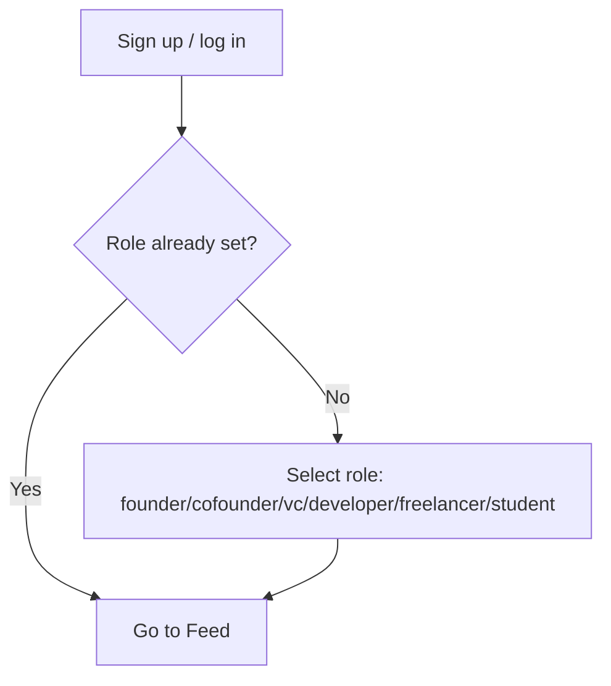
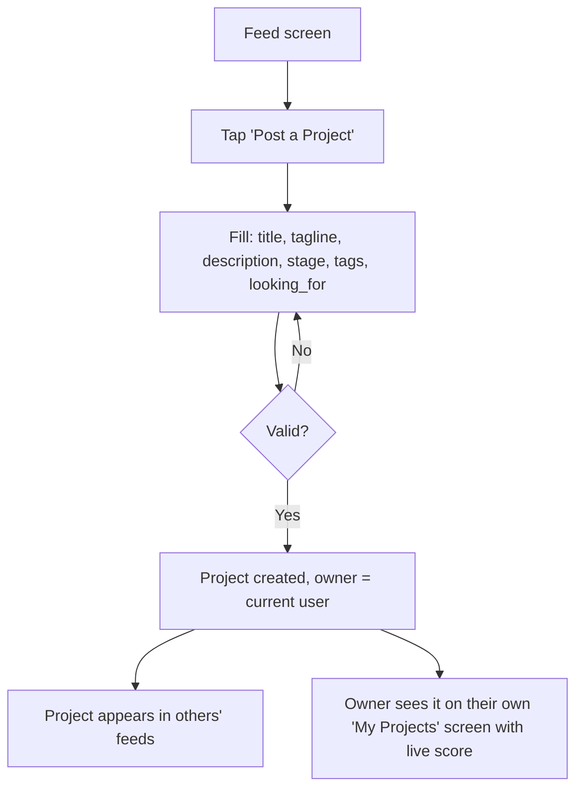
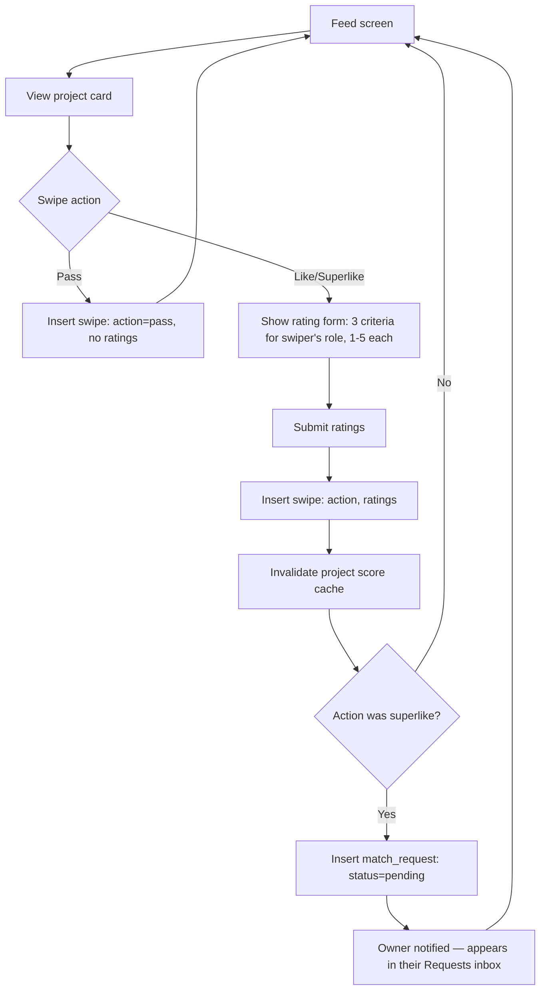
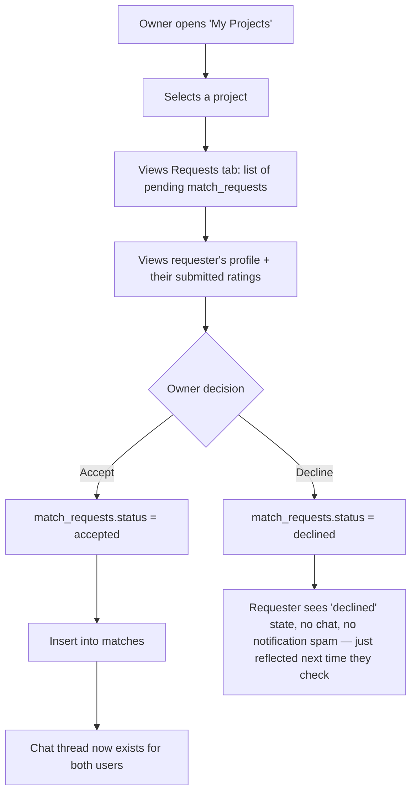
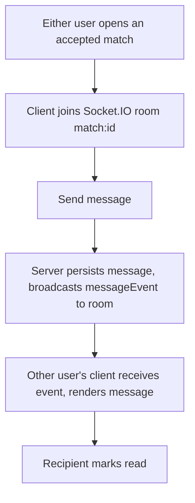
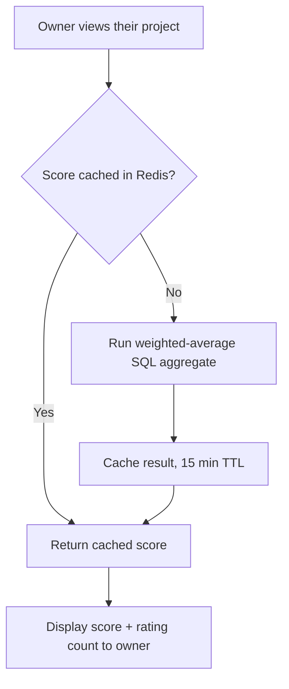
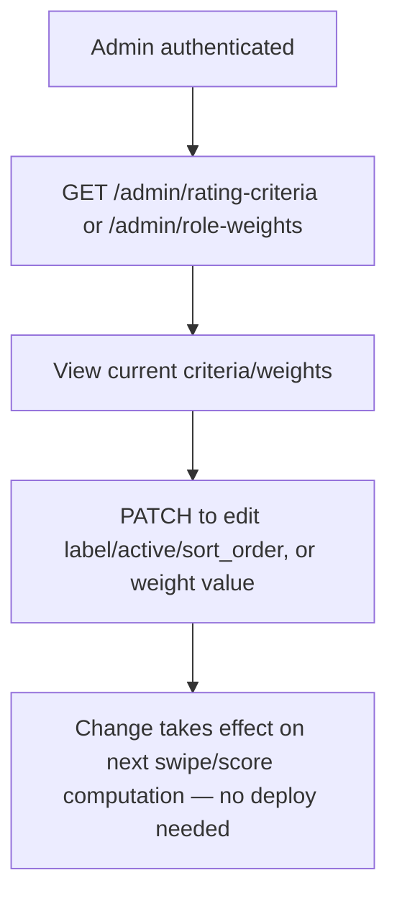

# App Flow Document — PairForge Projects

Every flow below ends in a defined terminal state — no path should leave the user stuck without a next action.

## 1. Onboarding / Role Selection

Role is set once at signup (matches existing PairForge `profiles.role`). Changing role after signup is out of scope for MVP — if a user's role changes in real life, that's a support/admin action, not a self-serve settings screen.

## 2. Posting a Project

## 3. Swipe & Rate

Note: rating is required for like and superlike, not for pass — there's nothing meaningful to rate on a pass.

## 4. Owner Reviews Requests (mutual approval)

This is the flow that implements mutual approval: a superlike alone never opens a chat. It only creates a request the owner must act on.

## 5. Chat

Matches existing PairForge `Socket.IO Event Flow` diagram exactly — no new pattern introduced.

## 6. Viewing Project Score (owner-facing)

Score is owner-facing only for MVP — other users see a project card to swipe on, not its running score. (Flag if you actually want the score visible to everyone, e.g. as social proof — that's a one-line UI change, not a schema change, but worth deciding explicitly since it affects whether swiping is influenced by prior raters.)

## 7. Admin: Managing Rating Criteria / Weights

No UI screen for this in MVP — an admin using the API directly (Postman, curl, or a future thin screen) is sufficient.
