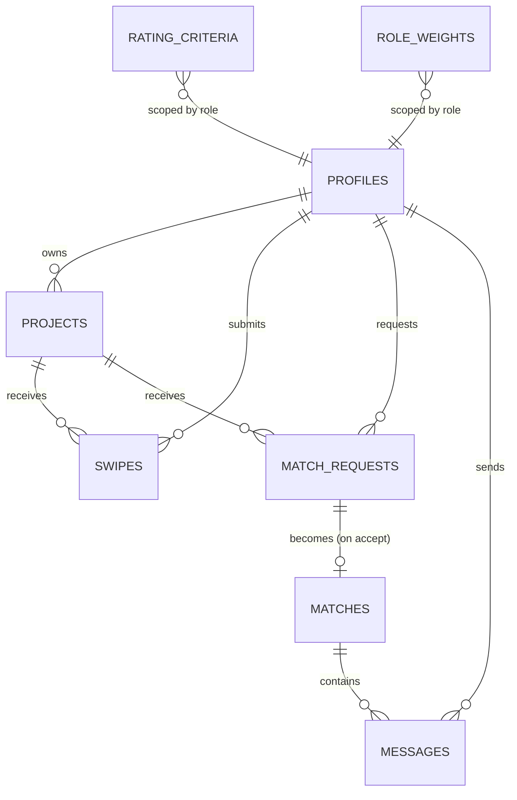

# Backend Schema Document — PairForge Projects

This is the schema validated across the earlier scoping conversation — reproduced here as the authoritative version for build purposes, with indices and notes added.

## 1. Enums

```sql
create type user_role as enum ('founder','cofounder','vc','developer','freelancer','student');
create type project_stage as enum ('idea','prototype','mvp','launched');
create type swipe_action as enum ('pass','like','superlike');
create type request_status as enum ('pending','accepted','declined');
```

## 2. Tables

### `profiles` (existing table — this feature adds a column if not already present)

```sql
alter table profiles add column if not exists role user_role not null;
```

Assumes `users`/`profiles` already exist per the repo's `Database Schema (ERD).puml`. Do not recreate these tables.

### `rating_criteria`

```sql
create table rating_criteria (
  id uuid primary key default gen_random_uuid(),
  role user_role not null,
  key text not null,
  label text not null,
  sort_order int not null default 0,
  active boolean not null default true,
  unique (role, key)
);
create index idx_rating_criteria_role_active on rating_criteria (role, active);
```

Seed data:

| role | key | label |
|---|---|---|
| vc | market_size | Market Size |
| vc | monetization | Monetization Path |
| vc | investability | Investability |
| developer | feasibility | Technical Feasibility |
| developer | scope_clarity | Stack/Scope Clarity |
| developer | would_build | Would I Build This |
| freelancer | clarity | Project Clarity |
| freelancer | fair_scope | Fair Scope for Engagement |
| freelancer | would_take | Would I Take This On |
| student | learning | Learning Value |
| student | interest | Personal Interest |
| student | approachable | Approachable for a Student |
| founder | originality | Idea Originality |
| founder | founder_fit | Founder-Market Fit |
| founder | would_cofound | Would I Cofound |
| cofounder | originality | Idea Originality |
| cofounder | founder_fit | Founder-Market Fit |
| cofounder | would_cofound | Would I Cofound |

### `role_weights`

```sql
create table role_weights (
  role user_role primary key,
  weight numeric not null default 1.0
);
```

Seed data: vc 1.5, founder 1.2, cofounder 1.2, developer 1.1, freelancer 1.0, student 0.8.

### `projects`

```sql
create table projects (
  id uuid primary key default gen_random_uuid(),
  owner_id uuid not null references profiles(id),
  title text not null,
  tagline text not null,
  description text not null,
  stage project_stage not null,
  looking_for text[] not null default '{}',
  tags text[] not null default '{}',
  created_at timestamptz default now()
);
create index idx_projects_owner on projects (owner_id);
```

### `swipes`

```sql
create table swipes (
  id uuid primary key default gen_random_uuid(),
  project_id uuid not null references projects(id),
  swiper_id uuid not null references profiles(id),
  action swipe_action not null,
  ratings jsonb not null default '{}',
  created_at timestamptz default now(),
  unique (project_id, swiper_id)
);
create index idx_swipes_project on swipes (project_id);
```

`ratings` keys must be validated server-side against `rating_criteria` for the swiper's role at insert time — this is application-layer logic (see TRD §2, swipes service), not a DB constraint, since jsonb key validation against a dynamic set isn't practical as a CHECK constraint.

### `match_requests`

```sql
create table match_requests (
  id uuid primary key default gen_random_uuid(),
  project_id uuid not null references projects(id),
  requester_id uuid not null references profiles(id),
  status request_status not null default 'pending',
  created_at timestamptz default now(),
  responded_at timestamptz,
  unique (project_id, requester_id)
);
create index idx_match_requests_project_status on match_requests (project_id, status);
```

### `matches`

```sql
create table matches (
  id uuid primary key default gen_random_uuid(),
  project_id uuid not null references projects(id),
  requester_id uuid not null references profiles(id),
  owner_id uuid not null references profiles(id),
  created_at timestamptz default now(),
  unique (project_id, requester_id)
);
create index idx_matches_owner on matches (owner_id);
create index idx_matches_requester on matches (requester_id);
```

### `messages`

```sql
create table messages (
  id uuid primary key default gen_random_uuid(),
  match_id uuid not null references matches(id),
  sender_id uuid not null references profiles(id),
  content text not null,
  created_at timestamptz default now()
);
create index idx_messages_match_created on messages (match_id, created_at);
```

## 3. Score Computation (reference query)

```sql
select
  s.project_id,
  sum(rater_avg * rw.weight) / sum(rw.weight) as success_score,
  count(*) as rating_count
from (
  select
    s.project_id,
    s.swiper_id,
    (select avg((v)::numeric) from jsonb_each_text(s.ratings) as t(k, v)) as rater_avg,
    p.role
  from swipes s
  join profiles p on p.id = s.swiper_id
  where s.action in ('like', 'superlike')
) s
join role_weights rw on rw.role = s.role
group by s.project_id;
```

Run on cache miss only (see TRD/Implementation Plan for the Redis caching layer — this query itself is not called on every request).

## 4. Entity Relationship Summary


