# Inconsistent Productions - Dev Dating App Ideas

---

# PairForge

# AI Recommendation & Matching System

### Detailed Architecture & Design Document

---

# 1\. Overview

The **PairForge AI Recommendation System** is responsible for generating **high-quality developer matches** by analyzing multiple signals including:

-   Tech stack compatibility
    
-   Interests
    
-   Developer experience
    
-   Project interests
    
-   Behavioral interactions
    
-   GitHub activity
    
-   Location preferences

The goal is to provide **highly relevant matches** that lead to:

-   meaningful conversations
    
-   project collaboration
    
-   romantic compatibility
    
-   developer networking

The system uses a **hybrid recommendation model** combining:

1.  Content-based filtering
    
2.  Collaborative filtering
    
3.  Graph-based similarity
    
4.  Behavioral ranking
    
5.  Machine-learning scoring

---

# 2\. Objectives

Primary goals:

1.  Increase match quality
    
2.  Increase conversation initiation
    
3.  Increase long-term engagement
    
4.  Promote project collaboration
    
5.  Surface compatible developers faster

Key success metrics:

-   Match acceptance rate
    
-   Message start rate
    
-   Conversation depth
    
-   Session retention
    
-   Pair programming sessions
    
-   Project creation rate

---

# 3\. AI System Architecture

High-level architecture:

```
User Data
   ↓
Feature Extraction Layer
   ↓
Embedding Generation
   ↓
Similarity Engine
   ↓
Candidate Generator
   ↓
Ranking Model
   ↓
Recommendation API
   ↓
Discovery Feed
```

---

# 4\. Data Sources

The AI system uses multiple data sources.

### 4.1 User Profile Data

Fields include:

```
user_id
tech_stack
years_experience
developer_role
location
interests
relationship_preference
bio
```

---

### 4.2 GitHub Integration

Optional developer profile signals:

```
public repositories
languages used
commit frequency
stars received
contribution graph
```

These help infer:

-   developer skill level
    
-   active technologies
    
-   open-source engagement

---

### 4.3 Behavioral Signals

Collected from app usage:

```
swipes
likes
passes
matches
chat activity
profile views
pair programming sessions
```

---

### 4.4 Social Signals

Derived signals:

```
shared communities
shared projects
mutual connections
```

---

# 5\. Feature Engineering

The feature pipeline converts raw data into **machine-readable vectors**.

---

## 5.1 Tech Stack Encoding

Example stacks:

```
React
Node.js
Flutter
Python
Rust
Go
```

Representation:

```
Tech vector
[1,0,1,0,0,1]
```

Using **multi-hot encoding**.

---

## 5.2 Interest Encoding

Example interests:

```
AI
Gaming
Startups
Fitness
Anime
Travel
```

Vector representation.

---

## 5.3 Experience Encoding

Categorical scale:

```
Beginner
Junior
Mid
Senior
Expert
```

Converted to numeric scale.

---

## 5.4 Geographic Distance

Distance calculated via:

```
Haversine formula
```

Distance converted into compatibility score.

---

# 6\. Embedding Generation

Each user becomes a **feature vector**.

Example:

```
UserVector =
[tech_stack_embedding,
 interests_embedding,
 experience_level,
 location_vector]
```

Optional advanced approach:

```
Transformer embeddings
Graph embeddings
```

---

# 7\. Candidate Generation

Before ranking, the system first **generates candidate matches**.

Candidate sources:

```
Nearby developers
Developers with shared tech stack
Developers with shared interests
Developers liked by similar users
```

Candidate pool size:

```
200–500 candidates
```

---

# 8\. Similarity Engine

Core similarity calculation.

### 8.1 Tech Stack Similarity

```
Jaccard similarity
```
```
|Intersection| / |Union|
```

---

### 8.2 Interest Similarity

```
Cosine similarity
```

---

### 8.3 Experience Compatibility

Absolute difference scoring.

---

### 8.4 Location Proximity

Distance-based scoring.

---

# 9\. Collaborative Filtering

Uses behavior patterns.

Example:

```
User A likes Flutter devs
User B likes Flutter devs
```

Recommend similar profiles.

Approaches:

```
matrix factorization
implicit feedback models
neural collaborative filtering
```

---

# 10\. Graph-Based Matching

The system can treat users as nodes.

Edges represent:

```
likes
messages
shared projects
```

Graph algorithms:

```
node similarity
link prediction
community detection
```

---

# 11\. Compatibility Score

Final compatibility formula.

Example weights:

```
tech_similarity       35%
interest_similarity   20%
experience_match      10%
location_proximity    10%
collaborative_score   25%
```

Formula:

```
score =
0.35 * tech +
0.20 * interests +
0.10 * experience +
0.10 * location +
0.25 * collaborative
```

---

# 12\. Ranking Engine

The ranking model sorts candidates.

Possible approaches:

### Simple ranking

```
weighted score
```

---

### ML-based ranking

Models:

```
Gradient Boosting
XGBoost
LightGBM
Neural ranking models
```

Input features include:

```
profile similarity
behavioral similarity
interaction probability
```

---

# 13\. Recommendation API

The mobile app calls:

```
GET /matches/suggestions
```

Response:

```
{
  user_id
  compatibility_score
  shared_tech
  shared_interests
}
```

---

# 14\. Match Feedback Loop

User interactions feed back into the system.

```
swipe → training signal
message → engagement signal
match → success signal
```

These signals improve future recommendations.

---

# 15\. Caching Layer

To improve performance.

Match suggestions are cached.

```
Redis
```

Cache duration:

```
10–30 minutes
```

---

# 16\. Real-Time Adaptation

If user behavior changes:

```
new swipes
new interests
new projects
```

the system updates ranking.

---

# 17\. AI Service Architecture

Recommended stack:

```
Python
FastAPI
NumPy
Scikit-learn
Faiss (vector search)
Redis
```

---

# 18\. Vector Search Engine

For fast similarity lookup.

Recommended:

```
FAISS
Milvus
Weaviate
```

---

# 19\. Scalability Strategy

System must scale for:

```
1M users
```

Strategies:

```
candidate precomputation
batch ranking
vector indexing
distributed compute
```

---

# 20\. Offline Training Pipeline

Training occurs offline.

Pipeline:

```
data collection
feature engineering
model training
evaluation
deployment
```

Tools:

```
Airflow
Kubeflow
Spark
```

---

# 21\. Online Inference Pipeline

Runtime prediction pipeline:

```
user request
candidate retrieval
similarity calculation
ranking model
return suggestions
```

---

# 22\. Evaluation Metrics

Offline metrics:

```
precision
recall
AUC
```

Online metrics:

```
match rate
message rate
retention
```

---

# 23\. Experimentation

A/B testing recommended.

Example experiments:

```
different scoring weights
new ranking models
interest weight tuning
```

---

# 24\. Safety & Bias Handling

Important for fairness.

Measures:

```
avoid popularity bias
avoid geographic bias
balance new users exposure
```

---

# 25\. Privacy Considerations

User data protection.

Measures:

```
anonymized training data
encrypted storage
opt-in GitHub data
```

---

# 26\. Future Improvements

Possible future upgrades.

### Graph Neural Networks

Better relationship modeling.

---

### LLM-based Interest Understanding

Analyze bios and interests.

---

### Project Compatibility

Match developers by:

```
project goals
startup interests
tech stack needs
```

---

# 27\. Example Recommendation Flow

Step-by-step:

```
user opens discovery feed
system fetches candidate pool
similarity engine calculates scores
ranking engine sorts users
top 50 matches returned
```

---

# 28\. AI System Deployment

Recommended deployment.

```
Docker containers
Kubernetes
autoscaling
```

---

# 29\. Failure Handling

Fallback logic:

```
AI unavailable → basic rule-based matching
```

---

# 30\. Hypotheses

Key hypotheses behind the system.

1.  Developers prefer matching based on **tech compatibility**.
    
2.  Shared technical interests increase **conversation probability**.
    
3.  Collaborative features increase **retention**.
    
4.  GitHub signals improve **skill compatibility detection**.

---

# Conclusion

The PairForge AI system is designed as a **hybrid recommendation engine** combining:

-   behavioral data
    
-   profile similarity
    
-   graph relationships
    
-   machine learning ranking


## AI Matchmaking Service Implementation (My Contribution)

Location:
ai-services/matchmaking-service

This service implements the AI-powered matchmaking engine described in the architecture above.

Features:
- Developer skill embeddings using TF-IDF
- Compatibility scoring using cosine similarity
- Recommendation engine for similar developers
- REST API built using FastAPI

Key Endpoints:
GET /health
POST /match/score
GET /match/recommendations/{user_id}

# Architecture Diagrams

---

## AI System High-Level Architecture

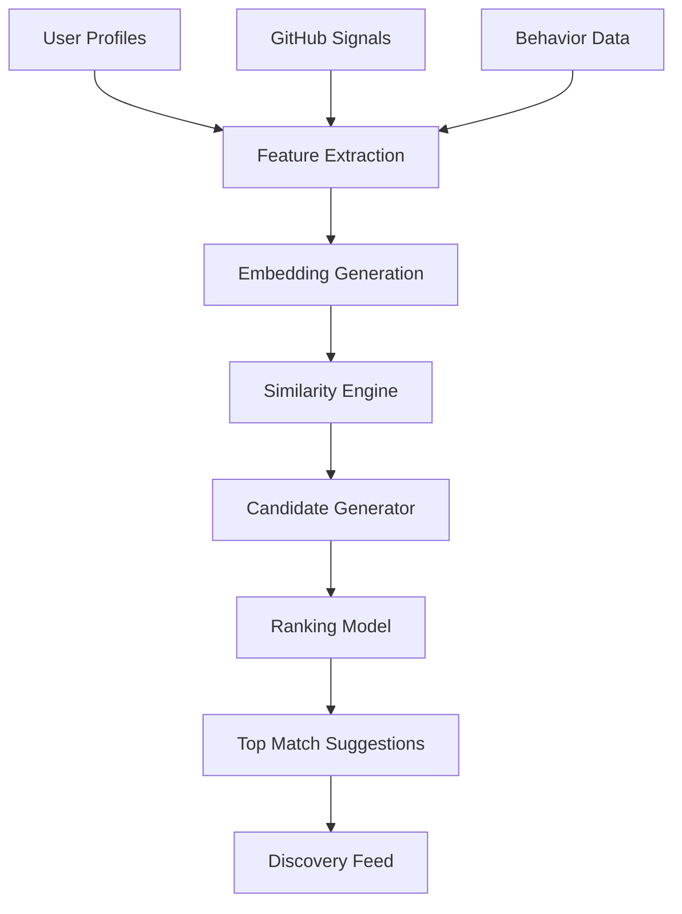

---

## Feature Engineering Pipeline

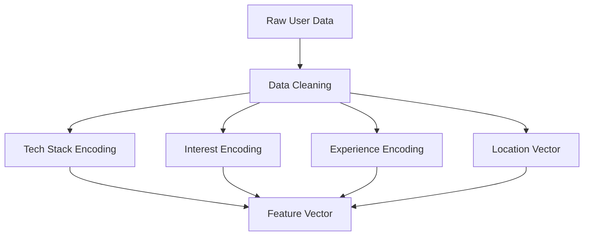

---

## Candidate Generation Flow

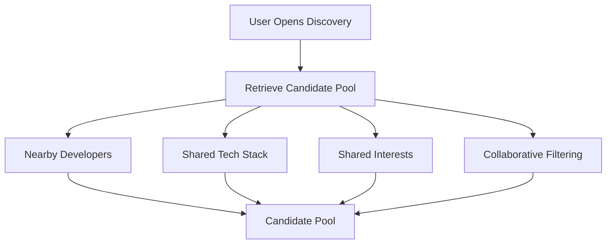

---

## Similarity Calculation

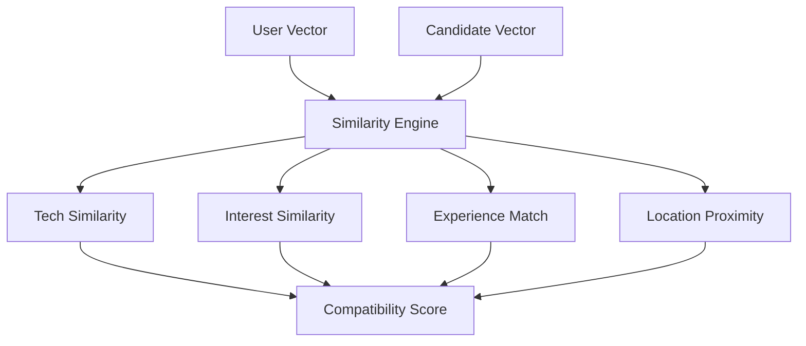

---

## Ranking Model Pipeline

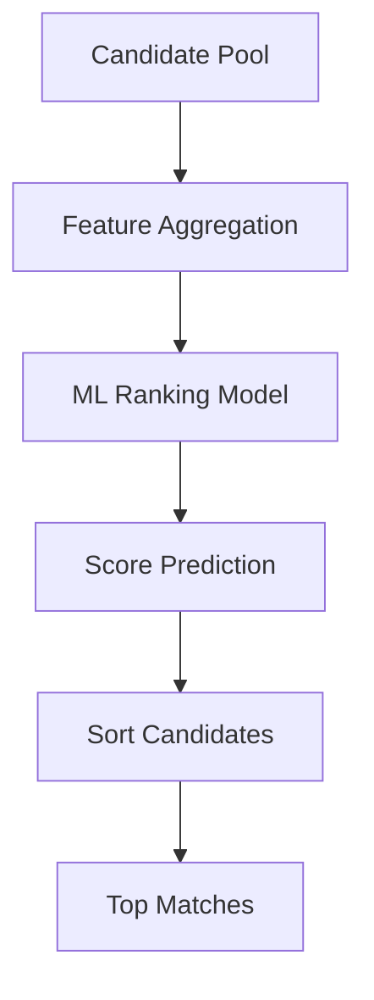

---

## Real-Time Inference Flow

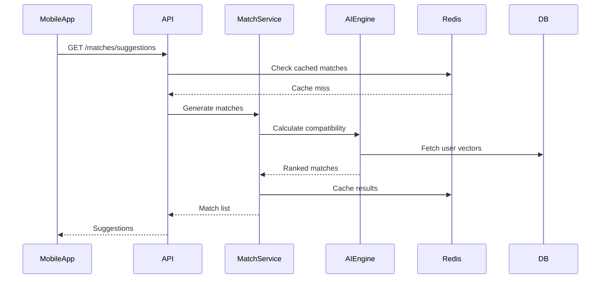

---

## AI Feedback Loop

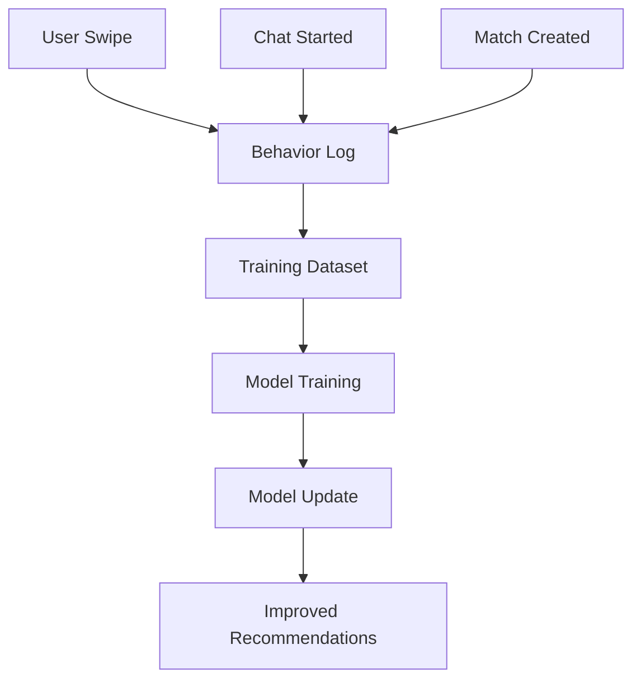

---

## Vector Search Architecture

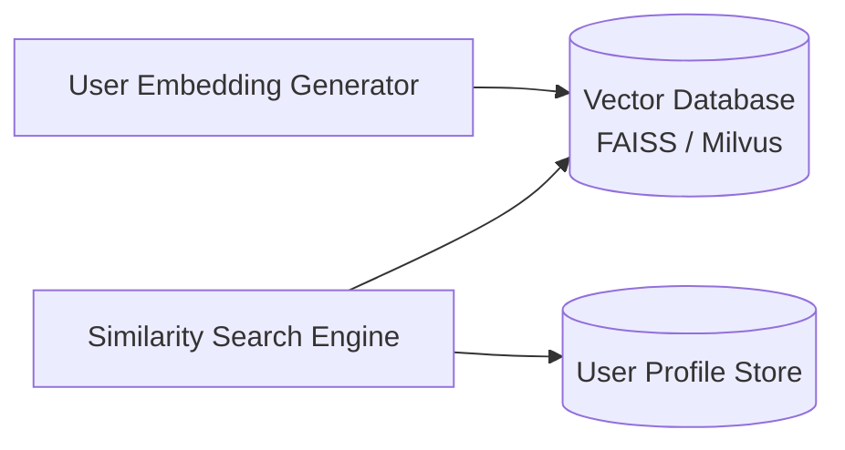

---

## AI Training Pipeline

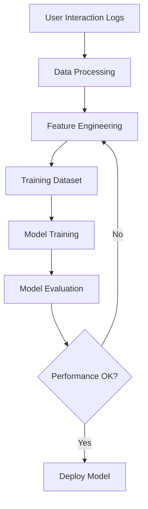

---

## AI Microservice Deployment

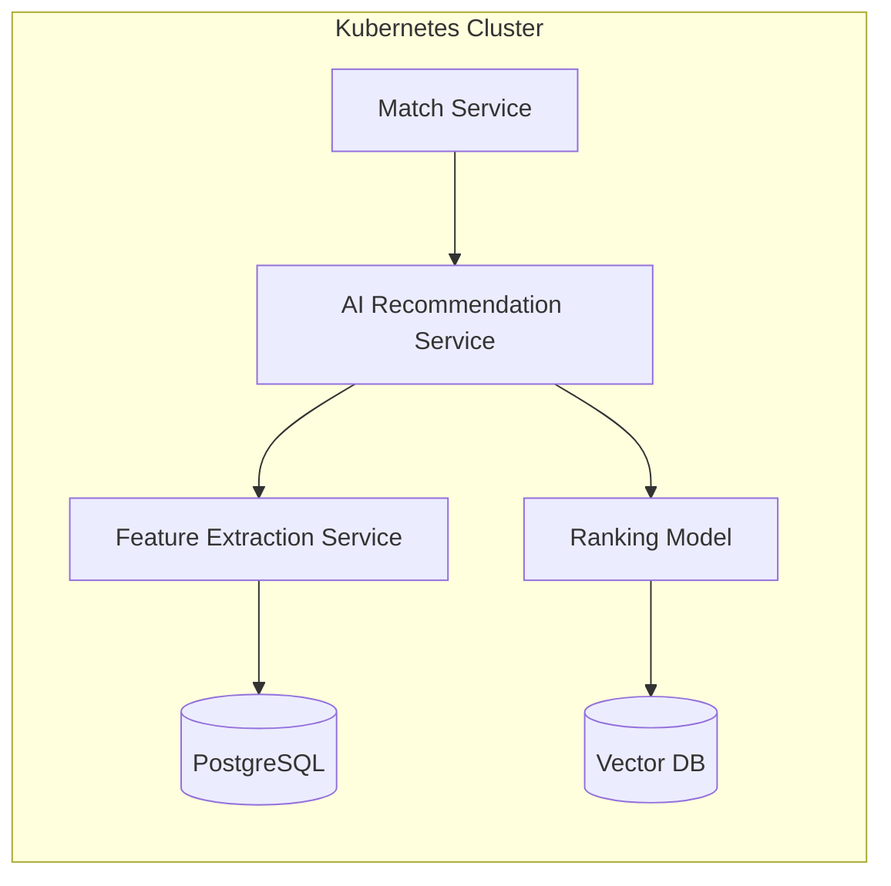

---

## Experimentation & A/B Testing

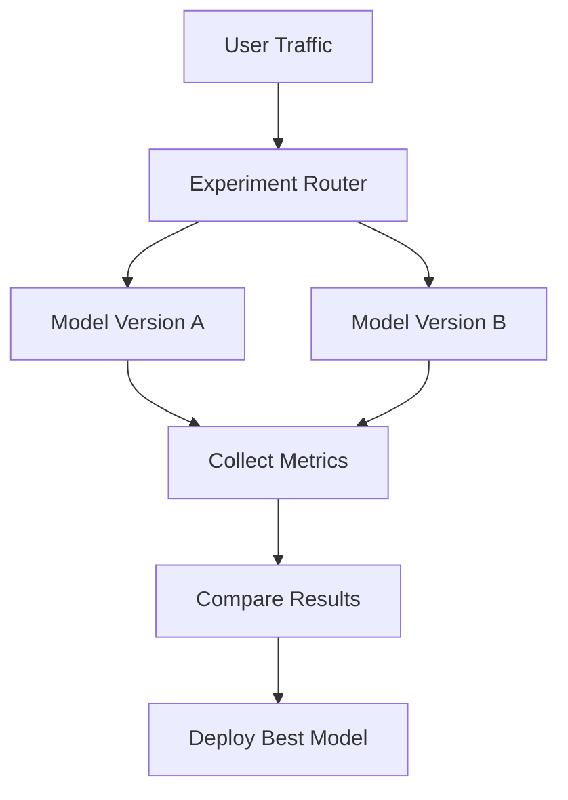

---

## Full AI Recommendation Flow

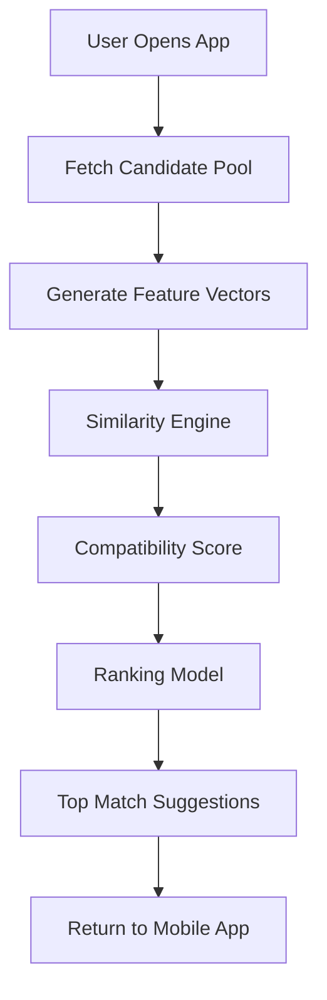

---

## Master Architecture

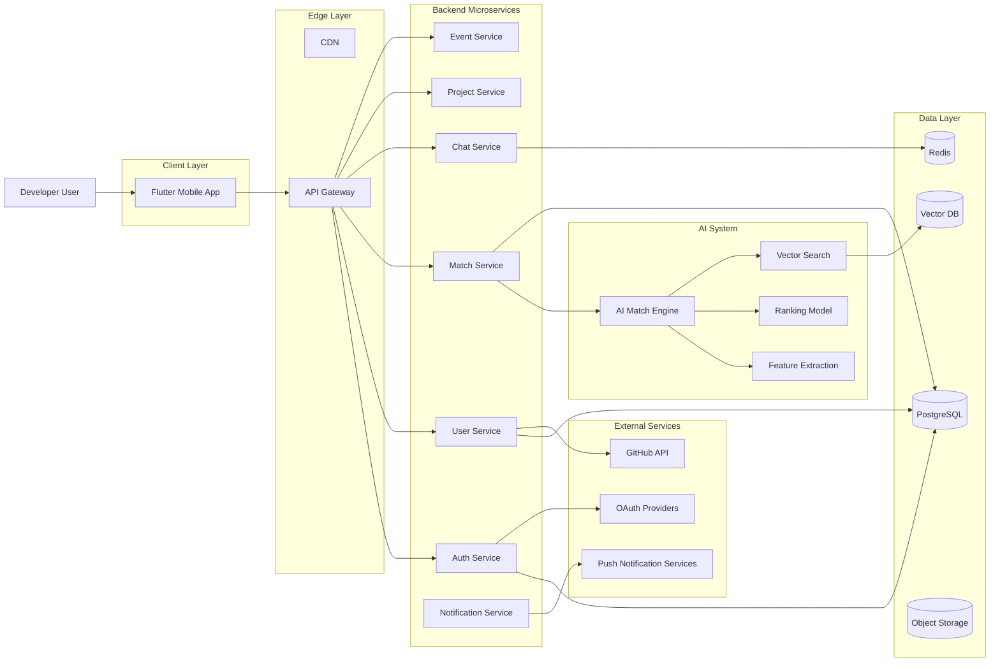

---

# AI Recommendation System — Detailed Architecture

## AI System End-to-End Flow

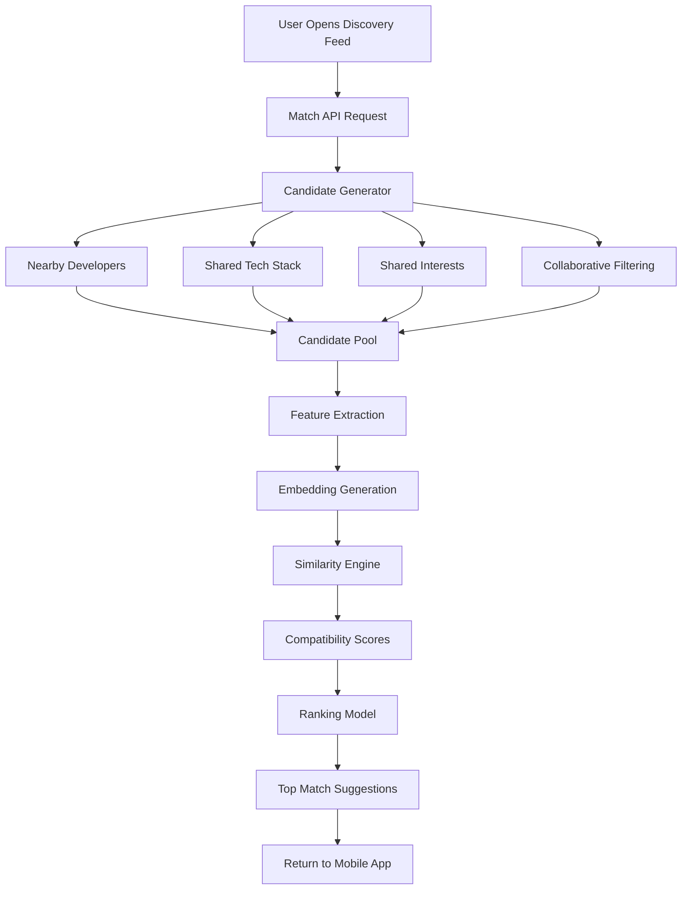

---

## AI Learning Loop

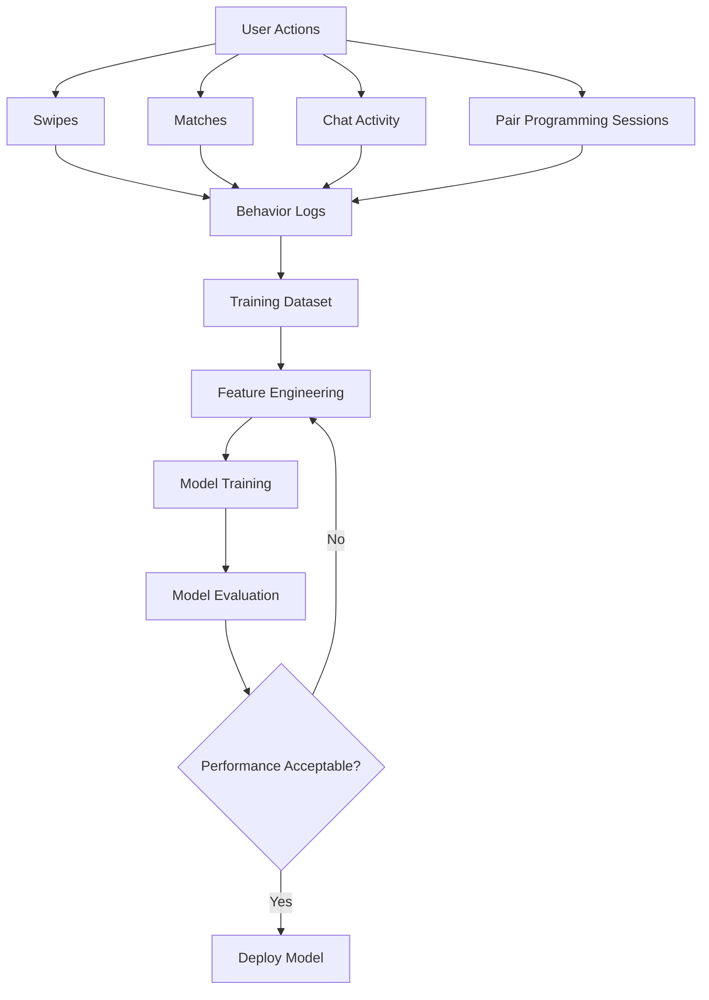

---

## AI Vector Search Architecture

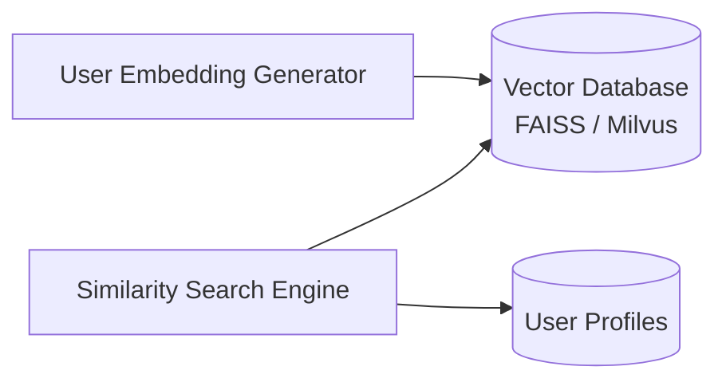

---

## Real-Time AI Inference Architecture

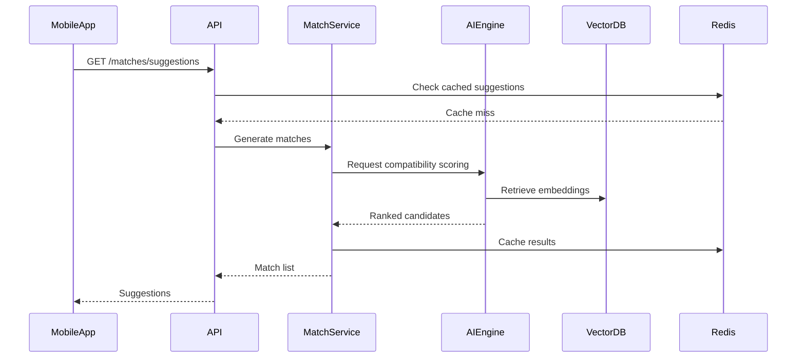

---

## AI Model Experimentation

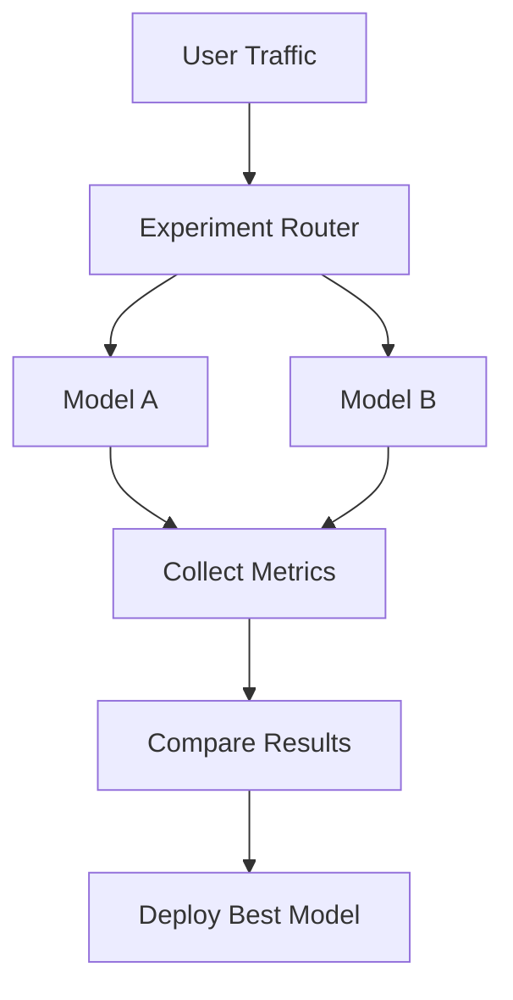

---

*Exported from ChatGPT · Thursday, March 5, 2026*

*Generated by [MD-Export](https://github.com/YadneshTeli/MD-Export)*
